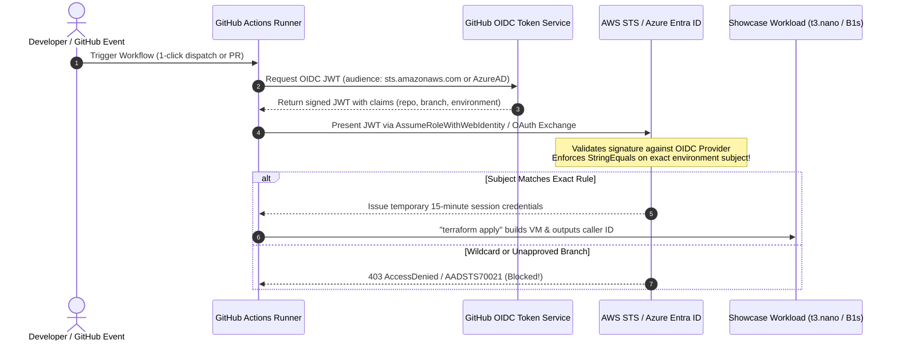

# IAM & OIDC Federation: Zero Long-Lived Cloud Credentials

> **Cloud:** AWS & Azure  
> **Core Concept:** OpenID Connect (OIDC) Workload Identity Federation  
> **Unique Angle:** Zero static secrets, automated 6-phase walkthrough harness, Checkov enterprise policy scanning, and a self-contained showcase VM deployed via 1-click CI/CD.

---

## What Problem Does This Solve?

### The Old Way: Permanent Secret Keys (High Risk)
Historically, connecting CI/CD (like GitHub Actions) to AWS or Azure required creating permanent credentials (`AWS_ACCESS_KEY_ID` / `AWS_SECRET_ACCESS_KEY` or an Azure Client Secret) and storing them in GitHub Secrets.
* **The danger:** If a secret leaks into workflow logs, git history, or a developer's machine, an attacker has unrestricted 24/7 cloud access until someone manually discovers and revokes it.

### The Modern Way: OIDC Federation (Zero Stored Secrets)
With OpenID Connect (OIDC), **zero cloud passwords or keys are stored in GitHub**.
* **The Hotel Keycard Analogy:** Static API keys are like permanent brass house keys—if lost, anyone can enter forever. OIDC is like a digital hotel keycard: GitHub presents a digitally signed passport (JWT token) specifying the exact repo and approved environment. The cloud verifies the signature and hands back a temporary token that **automatically expires after 15 minutes**.



---

## The Automated Build & Test Walkthrough

This project includes an **interactive end-to-end guided walkthrough harness** that automates the entire setup from zero, guides you through human approval steps, and records verbatim execution proof.

### Running the Walkthrough

Run locally with a single command:

```bash
# On Linux / macOS / Git Bash:
./demo-walkthrough.sh aws       # or ./demo-walkthrough.sh azure

# On Windows PowerShell:
.\demo-walkthrough.ps1 -Cloud aws   # or .\demo-walkthrough.ps1 -Cloud azure
```

### The 6 Automated Phases

```
+───────────────────────────────────────────────────────────────────────────────+
| Phase 1: Pre-flight Audit    -> Checkov IaC scanning + invariant tests        |
| Phase 2: State Bootstrap     -> Validates isolated S3 bucket / Storage Account|
| Phase 3: Identity & Trust    -> Configures OIDC Provider, Roles & Boundaries  |
| Phase 4: Interactive Pause   -> Outputs ARNs & WAITS for GitHub Env Setup     |
| Phase 5: Showcase Deployment -> Validates 1-click VM deploy/destroy workflow  |
| Phase 6: Verbatim Log        -> Automatically writes complete execution proof |
+───────────────────────────────────────────────────────────────────────────────+
```

#### The Interactive Pause in Action (Phase 4)
When it is time to link the cloud roles to GitHub, the script pauses execution and provides the exact environment variables:

```text
================================================================================
 PHASE 4: GITHUB ENVIRONMENT SETUP (INTERACTIVE PAUSE)
================================================================================
Please configure the following environment variables in your GitHub repository:
Navigate to: https://github.com/TheRicci/cloud-portfolio/settings/environments

1. In environment [aws-plan]:
   - AWS_REGION        = us-east-1
   - AWS_PLAN_ROLE_ARN = arn:aws:iam::123456789012:role/portfolio-tests/portfolio-gh-plan

2. In environment [aws-apply] (Enable Required Reviewers!):
   - AWS_REGION         = us-east-1
   - AWS_APPLY_ROLE_ARN = arn:aws:iam::123456789012:role/portfolio-tests/portfolio-gh-apply

[ACTION REQUIRED] Waiting for environment variables to be set in GitHub Settings...
👉 Press [ENTER] once you have verified or saved the variables to continue...
```

Once you press **Enter**, it completes the verification and records the full transcript into [`tests/results/walkthrough-execution-log.txt`](tests/results/walkthrough-execution-log.txt). See [docs/walkthrough.md](docs/walkthrough.md) for the in-depth pedagogical guide.

---

## Enterprise Tooling Added

### 1. Checkov Enterprise IaC Security Scanning
Instead of relying solely on custom scripts, this project incorporates **[Checkov](https://www.checkov.io/)** (by Palo Alto Networks / Bridgecrew), the industry gold-standard static analysis tool.

* **Configuration:** Defined in [`.checkov.yaml`](.checkov.yaml).
* **Targeted CIS & OIDC Rules:**
  * **`CKV_AWS_358`**: Official check ensuring IAM OIDC trust policies strictly require `sub` and `aud` claims.
  * **`CKV_AWS_1` & `CKV_AWS_62`**: Prohibits wildcard `*:*` administrative privileges.
  * **`CKV_AWS_19` & `CKV_AWS_21`**: Enforces S3 bucket encryption and versioning.
  * **`CKV_AZURE_3` & `CKV_AZURE_44`**: Enforces private storage accounts and minimum TLS 1.2.
* **Continuous Integration:** Runs automatically on every push and Pull Request via [.github/workflows/02-iam-oidc.yml](file:///c:/Users/Ricci/Documents/GitHub/cloud-portfolio/.github/workflows/02-iam-oidc.yml).

### 2. Self-Contained Showcase Workload ([workload/](workload/))
To verify OIDC within this project without depending on any other repository:
* **AWS Showcase ([workload/aws](workload/aws)):** Deploys a minimal VPC, security group, and **`t3.nano` EC2 VM** (~$0.005/hr).
* **Azure Showcase ([workload/azure](workload/azure)):** Deploys a minimal VNet, subnet, and **`Standard_B1s` Linux VM** (~$0.010/hr).
* **Proof Output:** Outputs the instance details and the `deployed_by_arn` / `deployed_by_client_id` proving it was created by the temporary OIDC identity.

### 3. 1-Click Clean Deployment via GitHub Actions
Configured in [.github/workflows/02-oidc-showcase-deploy.yml](file:///c:/Users/Ricci/Documents/GitHub/cloud-portfolio/.github/workflows/02-oidc-showcase-deploy.yml) using `workflow_dispatch`:
* **Zero Git Pollution:** You don't need to push throwaway commits or open dummy pull requests to test.
* **1-Click Web UI Options:**
  * **Action: `plan`** $\rightarrow$ Assumes the **Plan Role** via OIDC. Proves read-only inspection works.
  * **Action: `apply`** $\rightarrow$ Prompts for your approval in GitHub, assumes the **Apply Role**, and builds the VM.
  * **Action: `destroy`** $\rightarrow$ Tears down the VM in 60 seconds, leaving zero ongoing costs.

---

## Security Guardrails & Invariants (At a Glance)

Behind the scenes, 20 automated invariant checks ensure strict defense-in-depth:

| Security Guardrail | AWS Implementation | Azure Implementation |
|---|---|---|
| **No Wildcard Subjects** | Strict `StringEquals` matching on exact environment subject. Rejects `repo:org/*`. | Entra ID exact literal matching on `subject`. Rejects wildcards. |
| **Separation of Duties** | `portfolio-gh-plan` (read-only) vs. `portfolio-gh-apply` (deploy). | `id-portfolio-plan` (Reader) vs. `id-portfolio-apply` (Contributor). |
| **Blast Radius Limit** | **Permission Boundary** ceiling blocks creating admin backdoor roles. | **Resource Group Scope** with `NotActions` blocking role assignments. |
| **State Storage Isolation** | S3 bucket access locked strictly to state key prefix and `.tflock`. | RBAC scoped strictly to individual `tfstate` container. |

> Detailed audit breakdowns: [AWS Security Audit](tests/results/aws-security-audit.md) · [Azure Security Audit](tests/results/azure-security-audit.md).

---

## Directory Layout

```text
02-iam-oidc/
├── .checkov.yaml                   # Checkov enterprise IaC scanner configuration
├── demo-walkthrough.sh             # Interactive 6-phase walkthrough script (Linux/macOS)
├── demo-walkthrough.ps1            # Interactive 6-phase walkthrough script (Windows)
├── bootstrap/                      # Step 1: One-time local state-backend setup
│   ├── aws/                        # S3 bucket + encryption + TLS-only policy
│   └── azure/                      # StorageV2 account + private tfstate container
├── aws/                            # Step 2: AWS OIDC provider, plan/apply roles, boundary
├── azure/                          # Step 2: Entra apps, federated credentials, scoped RBAC
├── workload/                       # Step 3: Self-contained showcase VM workload
│   ├── README.md                   # Workload overview & cost breakdown
│   ├── aws/                        # Minimal VPC + Security Group + t3.nano EC2 VM
│   └── azure/                      # Minimal VNet + Subnet + NIC + Standard_B1s VM
├── tests/                          # Automated verification suite & proof evidence
│   ├── results/                    # Committed verification proof logs
│   │   ├── walkthrough-execution-log.txt # Full recorded transcript
│   │   ├── aws-verification-matrix.txt   # AWS Pass/Fail audit matrix
│   │   └── azure-verification-matrix.txt # Azure Pass/Fail audit matrix
│   ├── test_aws_oidc.py            # AWS security invariant assertions
│   └── test_azure_oidc.py          # Azure security invariant assertions
└── docs/                           # Architectural guides & activation runbooks
    ├── walkthrough.md              # In-depth 6-phase walkthrough guide
    ├── activation.md               # Step-by-step onboarding & environment setup
    ├── aws-vs-azure.md             # Technical comparison of the two trust models
    ├── design-decisions.md         # Architecture trade-offs & rationale
    └── trust-claims.md             # Verified OIDC claims reference sheet
```
