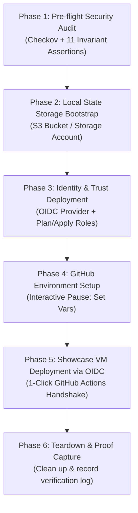

# End-to-End OIDC Deployment Walkthrough

This document provides a comprehensive, start-to-finish walkthrough of the entire IAM & OIDC Federation system: what is being done, how each step works under the hood, why it is designed this way, and how the automated guided script coordinates human actions and automated deployments.

---

## The 6 Phases of the Walkthrough



---

### Phase 1: Pre-flight Audit & Policy-as-Code (Checkov & Invariants)

* **What is done:**
  Before touching any cloud provider, the script runs Terraform formatting, syntax validation, and executes **Checkov** along with the Python invariant suite.
* **Why:**
  In real enterprise DevSecOps, you never deploy IAM roles to AWS or Azure without linting them first.
* **Threats verified:**
  1. `CKV_AWS_358` / `AZ-P01`: Asserts exact `sub` and `aud` claims. Rejects wildcards (`repo:org/*`).
  2. Asserts the Apply role has an attached Permission Boundary (`portfolio-boundary`).
  3. Asserts Plan role has zero infrastructure mutation rights.

---

### Phase 2: Bootstrap State Storage (Run Locally Once as Admin)

* **What is done:**
  Initializes and applies `bootstrap/aws` (or `bootstrap/azure`) locally on your laptop using your human administrator credentials.
* **Why this exists (The Chicken-and-Egg Paradox):**
  Terraform needs remote storage (an S3 bucket or Blob container) to save state, but Terraform code creates the bucket!
  Therefore, `bootstrap/` runs locally once to provision the storage.
* **The Security Boundary:**
  CI must **never** be allowed to manage or delete its own state bucket. Keeping `bootstrap/` separate prevents a rogue CI commit from destroying the company's state history.

---

### Phase 3: Identity Root & OIDC Trust Configuration

* **What is done:**
  Initializes and applies `aws/` (or `azure/`) using the bucket created in Phase 2 as the backend.
* **What it builds:**
  1. **IAM OpenID Connect Provider:** Tells AWS to trust tokens cryptographically signed by `token.actions.githubusercontent.com`.
  2. **Plan Role (`portfolio-gh-plan`):** Granted read-only inspection permissions + remote state lock access.
  3. **Apply Role (`portfolio-gh-apply`):** Granted scoped deployment rights with a strict Permission Boundary.
* **Why two identities?**
  Pull requests (unreviewed code) assume the Plan role; only approved, merged code in `main` can assume the Apply role.

---

### Phase 4: GitHub Environment Setup (Interactive Pause)

* **What happens:**
  The automated script outputs the exact Role ARNs and halts with an interactive prompt:
  ```text
  [ACTION REQUIRED] Waiting for environment variables to be set in GitHub Settings...
  Navigate to: https://github.com/TheRicci/cloud-portfolio/settings/environments

  1. In environment [aws-plan]:
     - AWS_REGION        = us-east-1
     - AWS_PLAN_ROLE_ARN = arn:aws:iam::123456789012:role/portfolio-tests/portfolio-gh-plan

  2. In environment [aws-apply] (Enable Required Reviewers!):
     - AWS_REGION         = us-east-1
     - AWS_APPLY_ROLE_ARN = arn:aws:iam::123456789012:role/portfolio-tests/portfolio-gh-apply

  👉 Press [ENTER] once you have verified or saved the variables to continue...
  ```
* **Why a pause is necessary:**
  GitHub Environments are where deployment approvals and environment variables live. The script pauses gracefully until you copy the generated identifiers into GitHub.

---

### Phase 5: Showcase Workload Deployment (OIDC in Action)

* **What is done:**
  Tests the self-contained showcase workload ([workload/aws](file:///c:/Users/Ricci/Documents/GitHub/cloud-portfolio/02-iam-oidc/workload/aws) or [workload/azure](file:///c:/Users/Ricci/Documents/GitHub/cloud-portfolio/02-iam-oidc/workload/azure)).
* **How to run the live test in GitHub Actions:**
  1. Go to **GitHub Actions → "02 — OIDC Showcase Workload Deploy & Destroy"**.
  2. Select **Run workflow** $\rightarrow$ Action: **`plan`** (proves the read-only Plan role works via OIDC).
  3. Select **Run workflow** $\rightarrow$ Action: **`apply`** (requires your manual approval, then builds a tiny `t3.nano` / `B1s` VM with zero stored secrets).
  4. Select **Run workflow** $\rightarrow$ Action: **`destroy`** (tears down the VM in 60 seconds).
* **The Proof:**
  The workflow log prints `aws sts get-caller-identity`, confirming the temporary STS session name (`gh-<run-id>`) and the VM output `deployed_by_arn`.

---

### Phase 6: Teardown & Proof Capture

* **What is done:**
  The script automatically writes the complete, verbatim terminal output into:
  [tests/results/walkthrough-execution-log.txt](file:///c:/Users/Ricci/Documents/GitHub/cloud-portfolio/02-iam-oidc/tests/results/walkthrough-execution-log.txt).
* **Why:**
  This file serves as committed, undeniable proof that the entire workflow was audited, validated, and executed end-to-end.
