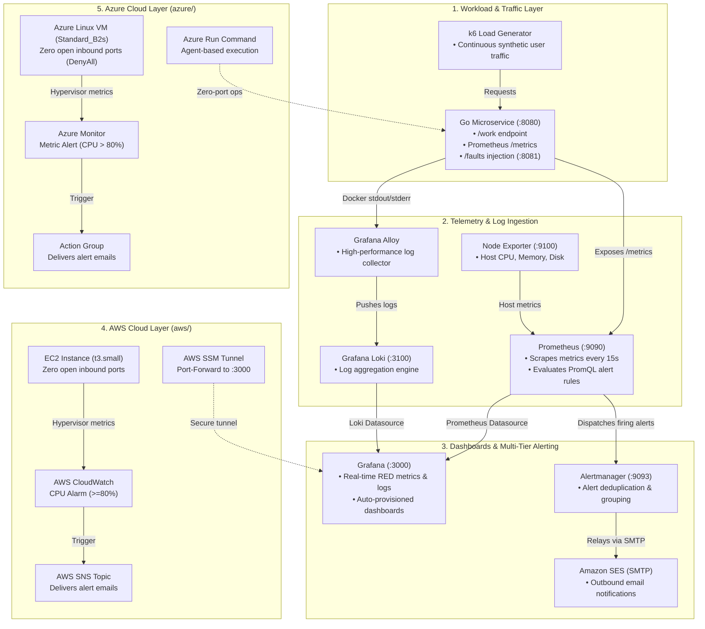
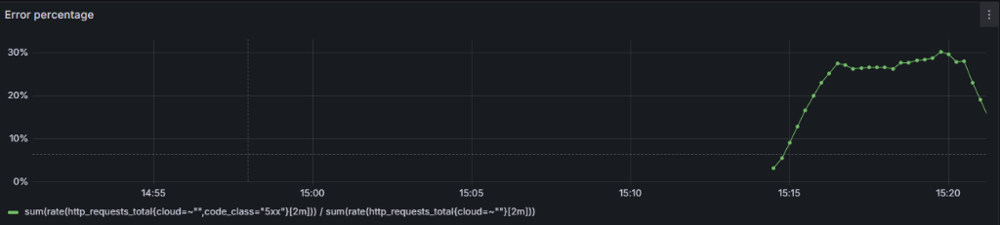
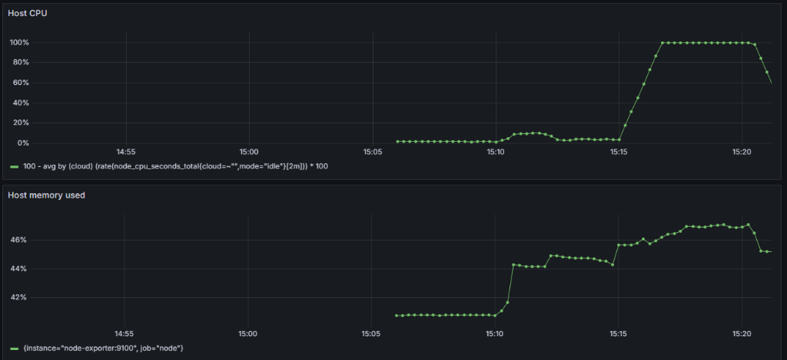
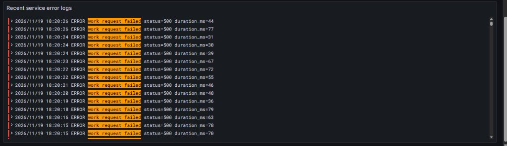
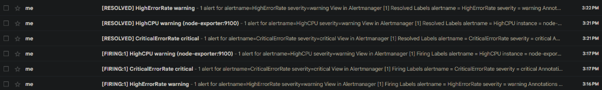

# Full-Stack Cloud Observability & Chaos Engineering Platform

A unified, production-grade observability and chaos engineering platform demonstrating **Metrics, Logs, Dashboards, Multi-Tier Alerting, and Self-Healing Infrastructure**.

Designed with a **dual-mode deployment architecture**: run it locally in **10 seconds** via Docker Compose, or deploy it as production Infrastructure-as-Code to **AWS (EC2, CloudWatch, SNS, SSM)** or **Azure (VM, Azure Monitor, Action Group, Run Command)** using Terraform.

---

## Architecture Overview



---

## Live Production Verification & Evidence

The following captures demonstrate live fault injection on AWS, real-time alert evaluation, notification dispatch, and automated self-healing.

### 1. Injected Error Rate Spike (RED Metrics)
When an error fault (`fault-error`) was injected into the Go service, the HTTP 5xx rate surged from **0% to ~30%**. Prometheus detected the breach, evaluated the rate over a 2-minute rolling window, and triggered `HighErrorRate` and `CriticalErrorRate`.



---

### 2. Host CPU Saturation & Memory Footprint
A controlled CPU burn (`fault-cpu`) was triggered using `stress-ng`. Host CPU was pinned at **100%**, triggering the Prometheus `HighCPU` node alert and CloudWatch alarm. Once the fault was cleared (`clean`), the CPU immediately normalized.



---

### 3. Real-Time Structured Log Aggregation (Grafana Loki)
During the error injection, **Grafana Alloy** captured stdout logs from the microservice container in real-time and streamed them into **Grafana Loki**. The logs were instantly queryable in the dashboard, displaying structured `status=500` error traces.



---

### 4. End-to-End Email Notification & Self-Healing Loop
Real email notifications delivered to the on-call inbox via **Amazon SES**:
- **Alert Ingestion:** Alertmanager received firing alerts for `HighErrorRate (warning)`, `CriticalErrorRate (critical)`, and `HighCPU (warning)`.
- **Deduplication & Routing:** Grouped notifications were dispatched cleanly.
- **Automated Resolution:** Once faults were cleared, Alertmanager delivered **`[RESOLVED]`** notifications for every alert.



---

## Key Features & Capabilities

### 1. The Three Pillars of Observability
- **Metrics (Prometheus & Node Exporter):**
  - **RED Metrics:** Tracks **Rate** (requests/sec), **Errors** (5xx response percentage), and **Duration** (p95 latency percentiles).
  - **USE Metrics:** Measures **Utilization**, **Saturation**, and **Errors** for CPU, Memory, and Disk.
- **Logs (Grafana Loki & Grafana Alloy):**
  - High-performance, low-footprint log collector tails Docker container logs and indexes them by container, job, and timestamp without indexing log lines.
- **Visualizations (Grafana):**
  - Fully automated dashboard and datasource provisioning. Zero manual setup needed upon container initialization.

### 2. Multi-Tier Alerting Architecture
- **Tier 1 — Application-Level (Prometheus → Alertmanager → Amazon SES):**
  - Evaluates business-logic degradation (`HighErrorRate`, `CriticalErrorRate`, `SlowResponses`, `ServiceDown`).
- **Tier 2 — Infrastructure-Level (AWS CloudWatch → Amazon SNS):**
  - Hypervisor-level metric tracking completely independent of the OS (`CPUUtilization >= 80%`).

### 3. Chaos Engineering & Live Fault Injection
The microservice exposes a dedicated admin API (`:8081/faults`) to inject controllable faults on demand:
- **Error Injection:** `curl -X POST /faults?error=0.25` (injects 25% HTTP 500 responses).
- **Latency Injection:** `curl -X POST /faults?delay_ms=400` (delays responses by 400ms).
- **CPU Stress:** Runs multi-threaded CPU burn to stress host resources.
- **Self-Healing:** `curl -X POST /faults?error=0&delay_ms=0` resets all faults back to normal.

### 4. Zero-Trust Security via AWS Systems Manager (SSM)
- The EC2 instance has **zero inbound ports open** (`ingress = []`).
- No SSH keys or public web ports are exposed to the internet.
- Administrators tunnel into the private Grafana dashboard (`localhost:3000`) and Prometheus (`localhost:9090`) through an encrypted IAM-authenticated **AWS SSM Session Manager** port-forwarding tunnel.

---

## Alert Rules & Threshold Reference

| Alert Name | Source | Condition | Duration | Severity |
| :--- | :--- | :--- | :--- | :--- |
| **HighErrorRate** | Prometheus | 5xx error rate > 5% | 1m | `warning` |
| **CriticalErrorRate** | Prometheus | 5xx error rate > 20% | 1m | `critical` |
| **SlowResponses** | Prometheus | p95 latency > 300ms | 1m | `warning` |
| **ServiceDown** | Prometheus | `up{job="service"} == 0` | 1m | `critical` |
| **HighCPU (Host)** | Prometheus | Host CPU utilization > 85% | 2m | `warning` |
| **CloudWatch High CPU** | AWS CloudWatch | EC2 `CPUUtilization >= 80%` | 5m | `alarm` |

---

## Getting Started

### Option A: Run Locally (10 Seconds)
No cloud account required.

```bash
# 1. Start all containers (Service, Prometheus, Alertmanager, Loki, Alloy, Grafana)
docker compose -f compose/docker-compose.yml up --build -d

# 2. Start synthetic background user traffic
bash demo.sh baseline

# 3. Check health status
bash demo.sh status
```

Open your browser:
- **Grafana Dashboard:** [http://localhost:3000](http://localhost:3000) (`admin` / `admin`)
- **Prometheus UI:** [http://localhost:9090](http://localhost:9090)
- **Alertmanager UI:** [http://localhost:9093](http://localhost:9093)

---

### Option B: Deploy to AWS (Terraform)

Deploy the complete single-node stack, VPC, CloudWatch alarms, and SNS topic with Terraform:

```bash
cd aws
terraform init
terraform plan
terraform apply
```

#### Accessing Grafana on AWS via SSM (Zero Inbound Ports)
Run this command in your local terminal:
```bash
aws ssm start-session \
  --target $(terraform -chdir=aws output -raw instance_id) \
  --region us-east-1 \
  --document-name AWS-StartPortForwardingSession \
  --parameters '{"portNumber":["3000"],"localPortNumber":["3000"]}'
```
Now navigate to **[http://localhost:3000](http://localhost:3000)** in your browser!

---

## Interactive Demo Runbook

Execute any of the incident scenarios either locally or remotely over AWS SSM:

```bash
# 1. Baseline Traffic (generates steady 5 req/s)
bash demo.sh baseline

# 2. Inject 25% HTTP 500 errors (triggers HighErrorRate & sends email)
bash demo.sh fault-error

# 3. Inject 400ms response latency (triggers SlowResponses)
bash demo.sh fault-latency

# 4. Stress CPU cores to 100% (triggers CloudWatch CPU alarm & SNS notification)
bash demo.sh fault-cpu

# 5. Clear all faults and demonstrate self-healing
bash demo.sh clean
```

*(To run any scenario on AWS via SSM, prepend: `aws ssm send-command --region us-east-1 --instance-ids <INSTANCE_ID> --document-name AWS-RunShellScript --parameters '{"commands":["/opt/observability/demo.sh <SCENARIO>"]}'`)*

---

### Option C: Deploy to Azure (Terraform)

Deploy the identical stack, VNet, Azure Monitor metric alert, and Action Group to Azure:

```bash
cd azure
terraform init
terraform plan
terraform apply
```

#### Running Scenarios on Azure via Run Command
Because the VM has **zero inbound ports open** (DenyAllInBound), manage and trigger scenarios securely with the Azure VM Agent:

```bash
az vm run-command invoke \
  --resource-group $(terraform -chdir=azure output -raw resource_group_name) \
  --name $(terraform -chdir=azure output -raw vm_name) \
  --command-id RunShellScript \
  --scripts "/opt/observability/demo.sh baseline"
```

---

## Teardown

```bash
# Locally:
docker compose -f compose/docker-compose.yml down -v

# On AWS:
cd aws && terraform destroy

# On Azure:
cd azure && terraform destroy
```
