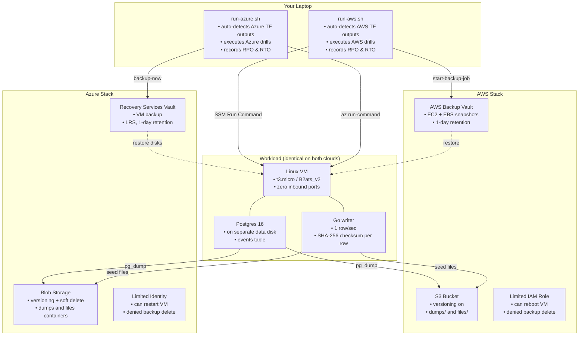

# Backup and Restore Lab — AWS & Azure

A dual-cloud backup and restore lab that proves every backup claim with a measured drill.
One tiny workload — a Linux VM running Postgres and a small Go writer — protected by native
backup tools on AWS and Azure. Dedicated automated scripts destroy resources, restore them,
and record exact RPO (data loss) and RTO (recovery time).

---

## Architecture



---

## Dedicated Step-by-Step Guides

AWS and Azure operations are completely independent:

- 📖 **[AWS Deployment & Drill Guide](docs/aws-guide.md)** — Deploy, execute drills, teardown, and verify costs on AWS.
- 📖 **[Azure Deployment & Drill Guide](docs/azure-guide.md)** — Deploy, execute drills, teardown, and verify costs on Azure.

---

## What It Demonstrates

| Drill | What breaks | How it's restored | What's measured | AWS Actual (`20261121T230347Z-aws`) | Azure Actual |
|---|---|---|---|:---:|:---:|
| **A — VM loss** | VM and data disk deleted | AWS Backup / Recovery Services restore | RTO, data loss (rows), WAL replay | **RTO: 219s** (data loss: 953 uncommitted rows, 0 corrupted) | *Pending* |
| **B — Bad data** | `DELETE FROM events` wipes rows | `pg_dump` restored from object storage | Rows lost (RPO gap of dump-only strategy) | **RTO: 2751s** (0 rows lost, 0 corrupted) | *Pending* |
| **C — File loss** | Files overwritten and deleted | S3 versioning / Blob soft-delete | Recovery time, hash verification | **Recovery: 94s** (20/20 files verified) | *Pending* |
| **D — Deletion protection** | Limited role tries to delete backups | IAM explicit deny / RBAC `not_actions` | Exact denial error codes | **Verified: 25s** (Reboot OK, Delete Vault/Points Denied) | *Pending* |
| **E — Restore testing** | Scripted restore to a new VM | Verify data on restored instance | End-to-end restore time | **Completed: 144s** (Clean launch & tag) | *Pending* |

---

### Verified Drill Results & Terminal Evidence (AWS Session `20261121T230347Z-aws`)

Every drill is executed programmatically by `tests/run-aws.sh` with zero manual intervention. Full artifacts and raw JSON logs are preserved in [`tests/results/20261121T230347Z-aws/`](tests/results/20261121T230347Z-aws/).

#### Drill A — VM Loss & Crash-Consistent Restore
**Scenario:** While the Go writer continuously inserts rows into PostgreSQL on the secondary EBS volume, the EC2 instance is terminated without a clean OS shutdown.  
**Outcome:** Restored via AWS Backup recovery point AMI to a new EC2 instance in **120s**. PostgreSQL replayed the WAL cleanly on startup with **0 corrupted rows**. Measured an RTO of 219s and an RPO loss of 953 rows (rows inserted after the crash-consistent snapshot began).
```bash
2026-11-21T23:22:26Z  last row: id=2772 at=2026-11-2123:22:17.527233+00
2026-11-21T23:22:26Z  terminating EC2 VM...
2026-11-21T23:23:00Z  EC2 VM terminated
2026-11-21T23:23:02Z  restoring from recovery point: arn:aws:ec2:us-east-1::image/ami-051b1adf907ba1fab
2026-11-21T23:23:11Z  restore job started: 28aadae5-e6c4-4272-84e3-3e3b2461941f
2026-11-21T23:24:15Z    restore job 28aadae5-e6c4-4272-84e3-3e3b2461941f: RUNNING (60s)
2026-11-21T23:25:18Z    restore job 28aadae5-e6c4-4272-84e3-3e3b2461941f: COMPLETED (120s)
2026-11-21T23:25:19Z  restored instance: i-04759c1cffa43293c
2026-11-21T23:25:34Z  Postgres is running after restore
2026-11-21T23:25:44Z  restored row count: 1819 (pre-crash last row: 2772)
2026-11-21T23:25:54Z  checksum verification passed — 0 corrupted rows
2026-11-21T23:25:55Z  PASS  drill-a — restored and verified. RTO=219s, data_loss=953 rows
```

#### Drill B — Bad Data & Logical Dump Restore
**Scenario:** An application or operator error issues `DELETE FROM events WHERE id > 931`, destroying half the dataset.  
**Outcome:** Downloaded logical backup (`pg_dump`) from S3, created a temporary staging database, validated checksums on all 2,761 rows with **0 corrupted rows**, and restored the table. Demonstrates zero data loss against the backup timestamp.
```bash
2026-11-21T23:26:05Z  pre-mistake last row: id=1862
2026-11-21T23:26:05Z  running bad DELETE: id > 931
DELETE 919
2026-11-21T23:26:26Z  rows after bad delete: 941 (was: 1862)
2026-11-21T23:26:26Z  restoring from logical dump: dump-20261121T230347Z-aws.sql
download: s3://backup-lab-488ca9ca92ec006e11ff96711d/dumps/dump-20261121T230347Z-aws.sql to /tmp/...
2026-11-22T00:09:16Z  rows in restored database: 2761
2026-11-22T00:09:47Z  restoring original backuplab database from dump...
2026-11-22T00:11:46Z  PASS  drill-b — checksums OK. rows_lost=0 (RPO gap). RTO=2751s
```

#### Drill C — S3 Object Corruption & Version Recovery
**Scenario:** Unauthorized activity overwrites 5 files with garbage and issues `DELETE` markers against 5 files.  
**Outcome:** Reverted overwritten objects by copying previous non-current versions in place, and restored deleted objects by deleting the delete markers. Verified all 20 SHA-256 hashes against `file-manifest.json` in **94s**.
```bash
2026-11-22T00:11:47Z  overwriting S3 files: testfile-001.txt ... testfile-005.txt
2026-11-22T00:11:47Z  deleting S3 files: testfile-006.txt ... testfile-010.txt
2026-11-22T00:12:02Z  S3 test files corrupted and deleted
2026-11-22T00:12:02Z  recovering S3 files from versions...
2026-11-22T00:12:32Z  S3 recovery operations complete
2026-11-22T00:13:20Z  file verification passed — all 20 files match
2026-11-22T00:13:20Z  PASS  drill-c — all S3 files recovered and verified in 94s
```

#### Drill D — IAM Deletion Protection
**Scenario:** A compromised operator assumes the `backup-lab-limited` IAM role to attempt deletion of backup vaults and recovery points.  
**Outcome:** Positive control verified the role has operational access (EC2 reboot succeeded). Negative controls verified that attempts to call `DeleteRecoveryPoint` and `DeleteBackupVault` are explicitly blocked by IAM deny policies.
```bash
2026-11-22T00:13:20Z  assuming limited IAM role: arn:aws:iam::5633****5515:role/backup-lab-limited
2026-11-22T00:13:25Z  PASS: EC2 reboot succeeded (positive control)
2026-11-22T00:13:42Z  attempting to delete recovery point (must be DENIED)...
2026-11-22T00:13:43Z  DENIED: delete-recovery-point — 
aws: [ERROR]: An error occurred (AccessDeniedException) when calling the DeleteRecoveryPoint operation: User: arn:aws:sts::... is not authorized to perform: backup:DeleteRecoveryPoint on resource: arn:aws:ec2:us-east-1::image/ami-051b1adf907ba1fab with an explicit deny in an identity-based policy
2026-11-22T00:13:44Z  attempting to delete vault (must be DENIED)...
2026-11-22T00:13:45Z  DENIED: delete-backup-vault — 
aws: [ERROR]: An error occurred (AccessDeniedException) when calling the DeleteBackupVault operation: User: arn:aws:sts::... is not authorized to perform: backup:DeleteBackupVault on resource: arn:aws:backup:us-east-1:...:backup-vault:backup-lab-vault with an explicit deny in an identity-based policy
2026-11-22T00:13:45Z  PASS  drill-d — deletion protection verified in 25s
```

#### Check E — Scripted Restore Testing
**Scenario:** Validates that backups are not just stored, but periodically testable and launchable without affecting production workloads.  
**Outcome:** Automated restore test spawned a new EC2 instance from the recovery point in **120s**, tagged it for audit compliance, and cleanly terminated it after validation (**144s total**).
```bash
2026-11-22T00:13:47Z  restore test from: arn:aws:ec2:us-east-1::image/ami-051b1adf907ba1fab
2026-11-22T00:13:56Z  restore test job: 1362c955-82f4-4e26-8e27-dced289d4ff3
2026-11-22T00:14:59Z    restore job 1362c955-82f4-4e26-8e27-dced289d4ff3: RUNNING (60s)
2026-11-22T00:16:02Z    restore job 1362c955-82f4-4e26-8e27-dced289d4ff3: COMPLETED (120s)
2026-11-22T00:16:04Z  test instance: i-03d30f672e19f6a6a
2026-11-22T00:16:06Z  cleaning up test instance: i-03d30f672e19f6a6a...
2026-11-22T00:16:09Z  PASS  check-e — AWS restore test completed in 144s
```

#### Automated Teardown & Leftover Audit
**Scenario:** Exit trap guarantees zero lingering resources or surprise cloud charges, even on early termination.  
**Outcome:** All test VMs, recovery points, unattached EBS volumes, and 23 Terraform resources destroyed, followed by an automated audit confirming 0 leftovers.
```bash
2026-11-22T00:16:09Z  === Auto-Teardown (exit trap) ===
2026-11-22T00:16:11Z  terminating instances: i-04759c1cffa43293c
2026-11-22T00:16:33Z    deleting recovery point arn:aws:ec2:us-east-1::image/ami-051b1adf907ba1fab
2026-11-22T00:16:36Z    deleting volume vol-073770e081f8b65ab
2026-11-22T00:16:39Z  running terraform destroy on AWS infrastructure...
Destroy complete! Resources: 23 destroyed.
2026-11-22T00:16:53Z  running audit to confirm complete removal...
=== AWS Leftover Audit (region=us-east-1) ===
AUDIT CLEAN — no AWS leftovers found.
```

---

## Verified Claims

| Claim | Source | Verified? |
|-------|--------|-----------|
| Azure Backup ~\$5/mo for VM ≤ 50 GB, prorated daily | Azure pricing docs | ✅ ~\$0.167/day |
| Azure public IP \$0.005/hr (Standard SKU) | Azure pricing | ✅ |
| AWS Backup restore from warm = free | AWS pricing | ✅ |
| AWS Backup warm storage \$0.05/GB-mo | AWS pricing | ✅ |
| Azure disk snapshot LRS \$0.05/GB-mo (incremental) | Azure pricing | ✅ |
| Azure vault soft delete can be disabled | Azure docs | ❌ **Always on** ("Secure by Default"). 14-day minimum, free, purgeable in teardown. |

---

## Quick Command Reference

### AWS Workflow
```bash
# 1. Deploy
cd aws && terraform init && terraform apply

# 2. Run session (auto-detects all outputs — zero manual exports)
cd .. && bash tests/run-aws.sh

# 3. Teardown & Audit (runs automatically on exit, or manually)
bash tests/teardown-aws.sh
bash tests/audit-aws.sh
```

### Azure Workflow
```bash
# 1. Deploy
cd azure && terraform init && terraform apply

# 2. Run session (auto-detects all outputs — zero manual exports)
cd .. && bash tests/run-azure.sh

# 3. Teardown & Audit (runs automatically on exit, or manually)
bash tests/teardown-azure.sh
bash tests/audit-azure.sh
```

---

## Teardown & Cleanliness

Teardown runs automatically on session exit (including failures and Ctrl+C interrupts). It:

1. Terminates restored/test VMs and deletes unattached disks
2. Cleans up backup items (AWS: deletes recovery points; Azure: handles soft-delete undelete → stop protection → delete data purge)
3. Runs `terraform destroy`
4. Runs the leftover audit

---

## Honest Limits

- **Crash-consistent snapshots.** AWS Backup and Azure Backup take crash-consistent snapshots of running Linux VMs, not application-consistent ones. Postgres should replay its WAL on startup, but that's an observed outcome — the drill reports whether it happened.
- **pg_dump RPO gap.** Rows written between the last dump and the disaster are lost. Closing this gap requires managed-database point-in-time restore, which this project leaves out.
- **Single account, same region.** No cross-region copy, no cross-account isolation.
- **Azure soft delete is mandatory.** Teardown must undelete → stop protection → delete data before the vault can be removed. No extra cost (14-day retention is free).

---

## What I Would Add in Production

Cross-region copy, cross-account or air-gapped vaults, immutable (locked) storage, managed-database point-in-time restore, cold or archive tiers, and automated scheduling with alerting on failed backup jobs.
